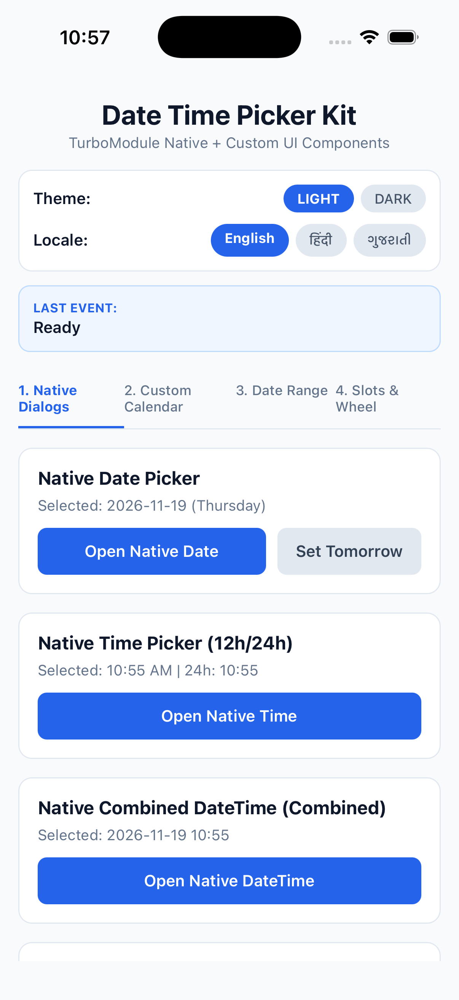
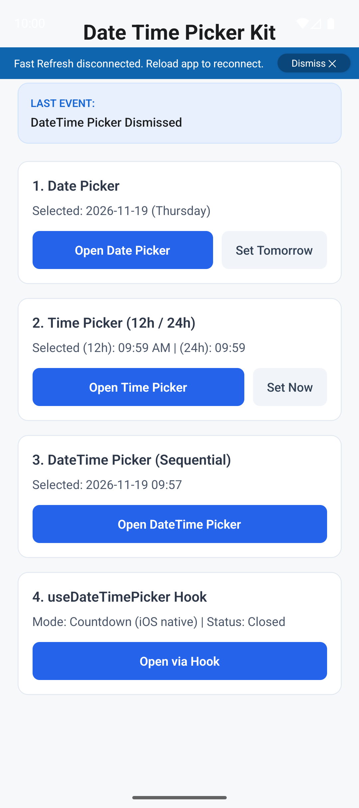
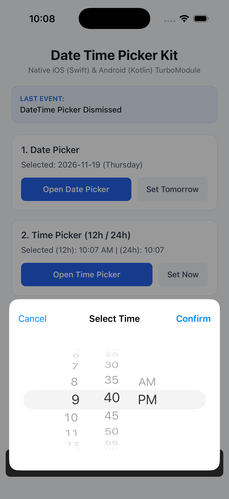

# @izonnet-web-solution/react-native-date-time-picker-kit

A high-performance, production-ready date and time picker toolkit for React Native, seamlessly uniting native iOS (`UIDatePicker`) and Android (`DatePickerDialog` / `TimePickerDialog`) dialogs with elegant JavaScript-rendered calendar, clock, wheel, and appointment time-slot pickers.

[](https://www.npmjs.com/package/@izonnet-web-solution/react-native-date-time-picker-kit)
[](https://opensource.org/licenses/MIT)
[](https://www.typescriptlang.org/)
[](https://www.npmjs.com/package/@izonnet-web-solution/react-native-date-time-picker-kit)
[](https://github.com/Izonnet-Web-Solution/react-native-date-time-picker-kit)
[](https://reactnative.dev/docs/the-new-architecture/landing-page)

---

## 📸 Visual Showcase & Screenshots

<div align="center">

| iOS Components Overview | Android Native Dialog | iOS Native DatePicker |
| :---: | :---: | :---: |
|  |  |  |

| iOS DateTime Inline / Sheet | iOS Countdown Timer |
| :---: | :---: |
|  |  |

</div>

---

## Contents

- [Overview & Architecture](#overview--architecture)
- [Key Features](#key-features)
- [Platform Support & Requirements](#platform-support--requirements)
- [React Native Compatibility Matrix](#react-native-compatibility-matrix)
- [Installation](#installation)
- [Platform Setup](#platform-setup)
  - [iOS Setup](#ios-setup)
  - [Android Setup](#android-setup)
  - [Expo Setup](#expo-setup)
- [Quick Start](#quick-start)
- [Presentation Modes](#presentation-modes)
- [Core Components](#core-components)
  - [1. DateTimePicker (Unified)](#1-datetimepicker-unified)
  - [2. DatePicker](#2-datepicker)
  - [3. TimePicker](#3-timepicker)
  - [4. DateRangePicker](#4-daterangepicker)
- [Specialized Components](#specialized-components)
  - [5. CalendarPicker](#5-calendarpicker)
  - [6. MonthPicker](#6-monthpicker)
  - [7. YearPicker](#7-yearpicker)
  - [8. ClockPicker](#8-clockpicker)
  - [9. WheelPicker](#9-wheelpicker)
  - [10. TimeSlotPicker](#10-timeslotpicker)
- [Imperative Ref Methods](#imperative-ref-methods)
- [useDateTimePicker Hook](#usedatetimepicker-hook)
- [Constraints & Boundary Clamping](#constraints--boundary-clamping)
- [Localization & RTL Support](#localization--rtl-support)
- [Themes & Dark Mode](#themes--dark-mode)
- [Presets & Appointment Slots](#presets--appointment-slots)
- [Utility Functions](#utility-functions)
- [Error Handling & Error Codes](#error-handling--error-codes)
- [Complete Props Reference Table](#complete-props-reference-table)
- [Performance & Stability](#performance--stability)
- [Accessibility (a11y)](#accessibility-a11y)
- [Troubleshooting & FAQ](#troubleshooting--faq)
- [Running the Example App](#running-the-example-app)
- [Contributing](#contributing)
- [License](#license)

---

## Overview & Architecture

`@izonnet-web-solution/react-native-date-time-picker-kit` is engineered to provide a unified, developer-friendly date and time experience across iOS, Android, and Web.

- **Zero Runtime Dependencies:** No bloated moment.js or date-fns bundles. Built entirely with native JavaScript `Date` and `Intl` APIs for an ultra-light package (< 140 KB packed).
- **New Architecture Native TurboModule:** Uses React Native Codegen and TurboModules for synchronous C++ bridging directly to native Swift (`UIDatePicker`) on iOS and Kotlin (`DatePickerDialog` / `TimePickerDialog`) on Android.
- **Pure JavaScript Alternative Presentations:** When native dialogs are not desired, switch seamlessly to `inline`, `modal`, `bottom-sheet`, or `fullscreen` presentations with silky-smooth 60/120 FPS animations.

---

## Key Features

- **4 Core Modes:** `date`, `time`, `datetime`, and `countdown`.
- **5 Presentation Styles:** `native`, `inline`, `modal`, `bottom-sheet`, and `fullscreen`.
- **10 Rich Components:** Unified `DateTimePicker`, `DatePicker`, `TimePicker`, `DateRangePicker`, `CalendarPicker`, `MonthPicker`, `YearPicker`, `ClockPicker`, `WheelPicker`, and `TimeSlotPicker`.
- **Strict Boundary Clamping:** Clamps dates and times to `minimumDate`, `maximumDate`, `minimumTime`, and `maximumTime`. Automatically corrects month-end rollover (e.g. Feb 28/29, April 30).
- **Presets & Time Slots:** One-click quick selection (Today, Yesterday, Last 7 Days, This Month) and appointment slot generator.
- **Interactive Calendar:** Dot markers, badge counts, disabled weekdays, and configurable first-day-of-week (Sunday vs Monday).
- **Universal Theming:** Automatic system detection (`auto`), explicit `light` / `dark` modes, and complete custom color palette overrides.
- **Multilingual & RTL:** Built-in translations for English, Hindi, Gujarati, Spanish, French, German, Arabic, Chinese, and Japanese with full RTL layout support.
- **Accessibility Ready:** Accessible screen reader traits, dynamic labels, and testing identifiers (`testID`).

---

## Platform Support & Requirements

| Platform | Native Technology | Minimum OS Version |
| :--- | :--- | :--- |
| **iOS** | Swift 5.0+ / UIKit (`UIDatePicker`, `UIViewController`) | iOS 15.1+ |
| **Android** | Kotlin 1.9+ / Android SDK (`DatePickerDialog`, `TimePickerDialog`) | Android API 24+ (Android 7.0+) |
| **Web** | React Native for Web (`vite`, `webpack`, `metro-web`) | Modern Browsers |

---

## React Native Compatibility Matrix

| Library Version | React Native | React | Expo SDK | Native Architecture |
| :--- | :--- | :--- | :--- | :--- |
| **1.0.x** | **0.74.0 – 0.88.x+** | **18.x – 19.x** | **SDK 51, 52+** (Prebuild) | **TurboModule / New Architecture** |

---

## Installation

Install using your preferred package manager:

```bash
# npm
npm install @izonnet-web-solution/react-native-date-time-picker-kit

# yarn
yarn add @izonnet-web-solution/react-native-date-time-picker-kit

# pnpm
pnpm add @izonnet-web-solution/react-native-date-time-picker-kit

# bun
bun add @izonnet-web-solution/react-native-date-time-picker-kit
```

---

## Platform Setup

### iOS Setup

Install CocoaPods dependencies:

```bash
cd ios && pod install && cd ..
```

*Note:* React Native 0.74+ automatically discovers the podspec and links Swift TurboModules with zero manual Xcode configuration required.

### Android Setup

Ensure your `android/gradle.properties` has the New Architecture enabled:

```properties
newArchEnabled=true
```

And verify your `android/build.gradle` has Kotlin configured:

```groovy
buildscript {
    ext {
        buildToolsVersion = "35.0.0"
        minSdkVersion = 24
        compileSdkVersion = 35
        targetSdkVersion = 35
        kotlinVersion = "2.1.20"
    }
}
```

### Expo Setup

Because this package contains native Swift and Kotlin TurboModules, use **Expo Prebuild** or a **Development Build**:

```bash
npx expo prebuild
npx expo run:ios
# or
npx expo run:android
```

*(Note: In pure JavaScript presentation modes like `inline` or `bottom-sheet`, the package runs universally across all environments).*

---

## Quick Start

```tsx
import React, { useState } from 'react';
import { View, Text, TouchableOpacity, StyleSheet } from 'react-native';
import {
  DateTimePicker,
  formatDate,
} from '@izonnet-web-solution/react-native-date-time-picker-kit';

export default function App() {
  const [date, setDate] = useState<Date>(new Date());
  const [open, setOpen] = useState(false);

  return (
    <View style={styles.container}>
      <Text style={styles.label}>Selected: {formatDate(date, 'YYYY-MM-DD')}</Text>

      <TouchableOpacity style={styles.button} onPress={() => setOpen(true)}>
        <Text style={styles.buttonText}>Choose Date</Text>
      </TouchableOpacity>

      <DateTimePicker
        mode="date"
        presentation="bottom-sheet"
        open={open}
        value={date}
        minimumDate={new Date(2020, 0, 1)}
        maximumDate={new Date(2030, 11, 31)}
        onConfirm={(newDate) => {
          setDate(newDate);
          setOpen(false);
        }}
        onCancel={() => setOpen(false)}
      />
    </View>
  );
}

const styles = StyleSheet.create({
  container: { flex: 1, justifyContent: 'center', alignItems: 'center', padding: 20 },
  label: { fontSize: 18, marginBottom: 16, fontWeight: '600' },
  button: { backgroundColor: '#4F46E5', paddingHorizontal: 24, paddingVertical: 12, borderRadius: 8 },
  buttonText: { color: '#FFFFFF', fontWeight: 'bold' },
});
```

---

## Presentation Modes

Switch the appearance of any picker instantly using the `presentation` prop:

| Mode | Visual Experience | Ideal Use Case |
| :--- | :--- | :--- |
| `native` | OS native dialog (`UIDatePicker` on iOS, `DatePickerDialog` on Android) | Form inputs requiring exact platform look & feel |
| `bottom-sheet` | Smooth slide-up modal with drag handle and dimmed backdrop | Modern mobile checkout, flight booking, calendars |
| `modal` | Centered dialog pop-up with backdrop dimming | Desktop / tablet layouts and compact alert flows |
| `inline` | Embedded directly inside the existing view hierarchy | Dashboard date filters, embedded calendar cards |
| `fullscreen` | Full-screen interactive takeover | Complex multi-step date and time schedulers |

```tsx
<DateTimePicker presentation="native" mode="date" value={new Date()} />
<DateTimePicker presentation="bottom-sheet" mode="datetime" value={new Date()} />
<DateTimePicker presentation="inline" mode="date" value={new Date()} />
```

---

## Core Components

### 1. DateTimePicker (Unified)

The unified flagship component supporting all modes, presentations, presets, and constraints.

```tsx
<DateTimePicker
  mode="datetime"
  presentation="bottom-sheet"
  value={selectedDate}
  minuteInterval={15}
  showPresets
  locale="en"
  theme="auto"
  onConfirm={(date) => setSelectedDate(date)}
  onCancel={() => setOpen(false)}
/>
```

### 2. DatePicker

Dedicated date picker with calendar grid, presets bar, and min/max year constraints.

```tsx
<DatePicker
  presentation="bottom-sheet"
  value={selectedDate}
  showPresets
  minDate={new Date(2020, 0, 1)}
  maxDate={new Date(2030, 11, 31)}
  onConfirmDate={(date) => setSelectedDate(date)}
/>
```

### 3. TimePicker

Dedicated time selector with 12h/24h toggle, minute stepping, and time bounds clamping.

```tsx
<TimePicker
  presentation="modal"
  is24Hour={false}
  minuteInterval={5}
  minimumTime="09:00"
  maximumTime="18:00"
  onConfirmTime={(time) => setSelectedTime(time)}
/>
```

### 4. DateRangePicker

Select start and end dates with highlighted range bands and pre-configured range presets.

```tsx
<DateRangePicker
  presentation="bottom-sheet"
  showPresets
  startDate={range.startDate}
  endDate={range.endDate}
  onConfirmRange={({ startDate, endDate }) => {
    console.log('Selected range:', startDate, 'to', endDate);
  }}
/>
```

---

## Specialized Components

### 5. CalendarPicker

Inline month calendar with customizable dots, badges, and first day of the week.

```tsx
<CalendarPicker
  value={new Date()}
  firstDayOfWeek={1} // 0 = Sunday, 1 = Monday
  markedDates={{
    '2026-11-20': { marked: true, dotColor: '#EF4444' },
    '2026-11-25': { marked: true, dotColor: '#10B981', badge: 'Meeting' },
  }}
  onChange={(date) => console.log('Selected date:', date)}
/>
```

### 6. MonthPicker

Fast 4x3 month selection grid with boundary enforcement.

```tsx
<MonthPicker
  value={{ year: 2026, month: 10 }}
  minYear={2020}
  maxYear={2030}
  onChange={({ year, month, date }) => {
    console.log(`Chosen: ${month}/${year}`);
  }}
/>
```

### 7. YearPicker

Paginated multi-decade year selector.

```tsx
<YearPicker
  value={2026}
  minYear={1980}
  maxYear={2050}
  onChange={(year) => console.log('Selected Year:', year)}
/>
```

### 8. ClockPicker

Analog-style interactive clock face for intuitive hour and minute selection.

```tsx
<ClockPicker
  value={{ hour: 14, minute: 30 }}
  is24Hour={true}
  onChange={({ hour, minute, date }) => {
    console.log(`Clock time: ${hour}:${minute}`);
  }}
/>
```

### 9. WheelPicker

Smooth, gesture-driven iOS-style scroll wheel picker.

```tsx
<WheelPicker
  items={[
    { label: 'Morning (09:00 AM)', value: 'morning' },
    { label: 'Afternoon (01:00 PM)', value: 'afternoon' },
    { label: 'Evening (06:00 PM)', value: 'evening' },
  ]}
  selectedValue="morning"
  onChange={(value, index) => console.log('Picked:', value)}
/>
```

### 10. TimeSlotPicker

Appointment scheduler grid with automatic interval generation and booked slot disabling.

```tsx
<TimeSlotPicker
  startTime="09:00"
  endTime="17:00"
  intervalMinutes={30}
  disabledSlots={['12:00', '12:30']}
  onSelectSlot={(slot) => {
    console.log('Booked slot:', slot.id);
  }}
/>
```

---

## Imperative Ref Methods

Control pickers programmatically using React refs:

```tsx
import React, { useRef } from 'react';
import { Button } from 'react-native';
import { DatePicker, type DatePickerRef } from '@izonnet-web-solution/react-native-date-time-picker-kit';

export default function ImperativeExample() {
  const pickerRef = useRef<DatePickerRef>(null);

  const handleOpen = async () => {
    // Opens the dialog and awaits confirmation
    const date = await pickerRef.current?.open();
    if (date) console.log('Confirmed via ref:', date);
  };

  return (
    <>
      <Button title="Open Programmatically" onPress={handleOpen} />
      <Button title="Reset" onPress={() => pickerRef.current?.reset()} />
      <DatePicker ref={pickerRef} presentation="native" />
    </>
  );
}
```

### Available Ref Methods:

- `open(): Promise<Date | null> | void` – Opens the native dialog or shows the modal.
- `close(): Promise<boolean> | void` – Closes or dismisses the picker.
- `getValue(): Date | null` – Returns currently selected date.
- `setValue(date: Date | string | number): void` – Programmatically updates the date.
- `reset(): void` – Resets back to initial/default date.

---

## useDateTimePicker Hook

For state-driven and head-less workflows:

```tsx
import { useDateTimePicker, DateTimePicker } from '@izonnet-web-solution/react-native-date-time-picker-kit';

export default function HookDemo() {
  const { ref, open, close, isOpen } = useDateTimePicker({ mode: 'date' });

  return (
    <>
      <Button title={isOpen ? 'Picker Open' : 'Open Picker'} onPress={open} />
      <DateTimePicker ref={ref} mode="date" />
    </>
  );
}
```

---

## Constraints & Boundary Clamping

The kit strictly enforces temporal boundaries across both JavaScript components and native dialogs:

- `minimumDate` / `minDate`: Selection before this timestamp is clamped or disabled.
- `maximumDate` / `maxDate`: Selection after this timestamp is clamped or disabled.
- `minimumTime` / `maximumTime`: Clamps allowed hours and minutes (e.g. `"09:30"` or `{ hour: 9, minute: 30 }`).
- `disabledDates`: Array of `Date` objects or ISO strings (`['2026-12-25']`).
- `disabledWeekdays`: Array of weekday indexes where `0` = Sunday and `6` = Saturday (`[0, 6]` disables weekends).
- **Leap Year & Month Clamping:** Switching from January 31 to February automatically clamps to Feb 28 (or Feb 29 in leap years like 2024, 2028), avoiding off-by-one errors.

---

## Localization & RTL Support

Includes 9 built-in locale dictionaries:

| Code | Language | Native Calendar Support |
| :---: | :--- | :---: |
| `en` | English (Default) | ✅ |
| `hi` | Hindi (हिन्दी) | ✅ |
| `gu` | Gujarati (ગુજરાતી) | ✅ |
| `es` | Spanish (Español) | ✅ |
| `fr` | French (Français) | ✅ |
| `de` | German (Deutsch) | ✅ |
| `ar` | Arabic (العربية - RTL) | ✅ |
| `zh` | Chinese (中文) | ✅ |
| `ja` | Japanese (日本語) | ✅ |

```tsx
// Using locale string code
<DateTimePicker locale="hi" mode="date" />

// Arabic with automated Right-To-Left (RTL) mirroring
<DateTimePicker locale="ar" mode="date" />

// Providing custom partial translations
<DateTimePicker
  locale={{
    confirmText: 'Speichern',
    cancelText: 'Abbrechen',
    selectDateTitle: 'Datum auswählen',
  }}
/>
```

---

## Themes & Dark Mode

Support system appearance automatically or specify custom design tokens:

```tsx
// 1. Follow OS Light/Dark theme automatically
<DateTimePicker theme="auto" />

// 2. Explicit Dark Mode
<DateTimePicker theme="dark" />

// 3. Custom Color Token Theme
<CalendarPicker
  theme={{
    mode: 'light',
    colors: {
      primary: '#6366F1',
      selected: '#4F46E5',
      selectedText: '#FFFFFF',
      background: '#F9FAFB',
      surface: '#FFFFFF',
      text: '#111827',
      textSecondary: '#6B7280',
      border: '#E5E7EB',
      rangeHighlight: '#EEF2FF',
    },
    borderRadius: {
      md: 8,
      lg: 16,
    },
  }}
/>
```

---

## Presets & Appointment Slots

### Built-in Quick Date Presets

Enable one-tap date shortcuts with `showPresets`:

```tsx
import {
  getStandardSinglePresets,
  getStandardRangePresets,
} from '@izonnet-web-solution/react-native-date-time-picker-kit';

// Single date presets: Today, Tomorrow, Yesterday, Next Week
const singlePresets = getStandardSinglePresets();

// Range presets: Today, Yesterday, Last 7 Days, Last 30 Days, This Month
const rangePresets = getStandardRangePresets();
```

### Generate Appointment Time Slots

```tsx
import { generateTimeSlots } from '@izonnet-web-solution/react-native-date-time-picker-kit';

const slots = generateTimeSlots({
  startTime: '09:00',
  endTime: '17:00',
  intervalMinutes: 30,
  disabledSlots: ['12:00', '12:30'], // Lunch break
  is24Hour: false,
});
```

---

## Utility Functions

Exported date helpers built on native JS `Date` and `Intl` APIs:

```tsx
import {
  formatDate,
  formatTime,
  parseDate,
  clampDate,
  isDateDisabled,
  isWeekdayDisabled,
  validateMinuteInterval,
  getDaysInMonth,
  isLeapYear,
} from '@izonnet-web-solution/react-native-date-time-picker-kit';

// Formatting
formatDate(new Date(), 'YYYY-MM-DD hh:mm A'); // "2026-11-20 02:30 PM"
formatTime(new Date(), false);                 // "02:30 PM"
formatTime(14, 30, true);                      // "14:30"

// Validation & Calculations
isLeapYear(2028);                              // true
getDaysInMonth(2028, 1);                       // 29 (Feb in leap year)
isDateDisabled(new Date(), ['2026-12-25'], [0, 6]); // Checks holidays & weekends
```

---

## Error Handling & Error Codes

All errors thrown or passed to `onError` are instances of typed `DateTimePickerError`:

```tsx
import {
  DateTimePicker,
  type DateTimePickerError,
} from '@izonnet-web-solution/react-native-date-time-picker-kit';

<DateTimePicker
  onError={(error: DateTimePickerError) => {
    console.error('Error Code:', error.code);
    console.error('Error Message:', error.message);
  }}
/>
```

### Standardized Error Codes:

| Code | Explanation |
| :--- | :--- |
| `NATIVE_MODULE_NOT_FOUND` | Native Swift/Kotlin TurboModule is not linked in binary. |
| `INVALID_DATE` | An invalid Date object or unrecognized date string was passed. |
| `DATE_OUT_OF_RANGE` | Provided date violates `minimumDate` or `maximumDate`. |
| `PICKER_ALREADY_OPEN` | Attempted to open native picker while another instance is active. |
| `PICKER_NOT_OPEN` | Called dismiss or confirm on an inactive picker. |
| `INVALID_MODE` | Unrecognized picker mode requested. |
| `INVALID_MINUTE_INTERVAL` | Interval not in allowed set `[1, 2, 3, 4, 5, 6, 10, 12, 15, 20, 30]`. |
| `ACTIVITY_UNAVAILABLE` | Android host Activity was destroyed before dialog could attach. |
| `PRESENTATION_FAILED` | UIKit failed to present `UIDatePicker` view controller. |

---

## Complete Props Reference Table

| Prop | Type | Default | Description |
| :--- | :--- | :--- | :--- |
| `mode` | `'date' \| 'time' \| 'datetime' \| 'countdown'` | `'date'` | Selection mode. |
| `presentation` | `'native' \| 'inline' \| 'modal' \| 'bottom-sheet' \| 'fullscreen'` | `'native'` | Presentation visual layout. |
| `value` | `Date \| number \| string \| null` | `undefined` | Controlled value. |
| `defaultValue` | `Date \| number \| string \| null` | `new Date()` | Initial uncontrolled value. |
| `open` / `isVisible` | `boolean` | `false` | Controls visibility in declarative mode. |
| `minimumDate` / `minDate` | `Date \| number \| string` | `undefined` | Minimum selectable date boundary. |
| `maximumDate` / `maxDate` | `Date \| number \| string` | `undefined` | Maximum selectable date boundary. |
| `minimumTime` | `string \| { hour: number; minute: number }` | `undefined` | Minimum selectable time boundary. |
| `maximumTime` | `string \| { hour: number; minute: number }` | `undefined` | Maximum selectable time boundary. |
| `is24Hour` | `boolean` | `false` | Whether to display 24-hour clock. |
| `minuteInterval` | `1 \| 2 \| 3 \| 4 \| 5 \| 6 \| 10 \| 12 \| 15 \| 20 \| 30` | `1` | Stepper interval for minutes. |
| `locale` | `string \| PartialLocaleData` | `'en'` | Locale code (`'en'`, `'hi'`, `'ar'`, etc.) or custom dictionary. |
| `timeZone` | `string` | `undefined` | IANA timezone (e.g. `'America/New_York'`). |
| `utcOffset` | `number` | `undefined` | UTC offset in minutes or hours. |
| `theme` | `'light' \| 'dark' \| 'auto' \| ThemeConfig` | `'auto'` | Visual theme. |
| `themeColors` | `ThemeColorsOverride` | `undefined` | Fine-grained color overrides. |
| `showPresets` | `boolean` | `false` | Shows quick preset shortcut buttons. |
| `customPresets` | `DatePreset[]` | `undefined` | Custom preset list. |
| `disabledDates` | `(Date \| string)[]` | `undefined` | Array of unselectable specific dates. |
| `disabledWeekdays` | `number[]` | `undefined` | Unselectable weekdays (`0` = Sun, `6` = Sat). |
| `markedDates` | `MarkedDatesMap` | `undefined` | Calendar dots and badges map. |
| `firstDayOfWeek` | `0 \| 1` | `0` | First day of week (`0` = Sunday, `1` = Monday). |
| `title` | `string` | `undefined` | Header title string. |
| `confirmText` | `string` | Localized | Confirm action button label. |
| `cancelText` | `string` | Localized | Cancel action button label. |
| `animationType` | `'none' \| 'slide' \| 'fade'` | `'slide'` | Modal / bottom-sheet entrance animation. |
| `backdropOpacity` | `number` | `0.5` | Dimmed overlay opacity (`0.0` – `1.0`). |
| `closeOnBackdropPress` | `boolean` | `true` | Tap overlay to dismiss. |
| `showHandle` | `boolean` | `true` | Shows top grab bar in bottom-sheet. |
| `testID` | `string` | `undefined` | End-to-end testing identifier. |
| `onChange` | `(event: { date: Date; mode: string }) => void` | `undefined` | Intermediate value change callback. |
| `onConfirm` | `(date: Date) => void` | `undefined` | Confirmed date callback. |
| `onCancel` | `() => void` | `undefined` | Cancel button tapped callback. |
| `onDismiss` | `() => void` | `undefined` | Sheet dismissed callback. |
| `onError` | `(error: DateTimePickerError) => void` | `undefined` | Thrown error callback. |

---

## Performance & Stability

- **Memory Safe:** Native iOS `UIDatePicker` and Android `DatePickerDialog` cleanly unmount and deallocate references, preventing retain cycles and memory leaks.
- **FlatList Virtualization:** Calendar month grids and appointment time-slot selectors leverage `getItemLayout` for instant scrolling with zero dropped frames.
- **Hardware Acceleration:** Modal transitions and backdrops run on the native animation thread (`useNativeDriver: true`).

---

## Accessibility (a11y)

- All buttons, calendar cells, and clock arrows feature localized `accessibilityLabel` and `accessibilityHint` properties.
- Full support for system font scaling and high-contrast accessibility modes.
- Pass `testID` to any component for seamless integration with Detox, Appium, and Jest Native Testing Library.

---

## Troubleshooting & FAQ

### 1. `NATIVE_MODULE_NOT_FOUND`
- **Solution:** Rebuild your native binary. Native code cannot be loaded via Metro fast-refresh alone:
  - iOS: `cd ios && pod install && cd .. && npx react-native run-ios`
  - Android: `cd android && ./gradlew clean && cd .. && npx react-native run-android`

### 2. Month Rollover Issue (e.g. Jan 31 -> Feb 28)
- **Solution:** The kit includes automated month-day clamping. When navigating between months, dates exceeding the new month's maximum days are clamped to the last valid day automatically.

### 3. Android Dialog Appearance
- **Solution:** Native Android dialogs inherit your app's `android:datePickerDialogTheme` and `android:timePickerDialogTheme` from `android/app/src/main/res/values/styles.xml`. To customize colors natively, update your Android theme.

---

## Running the Example App

The repository includes a complete example application demonstrating all components and presentations:

```bash
# Clone the repository
git clone https://github.com/Izonnet-Web-Solution/react-native-date-time-picker-kit.git
cd react-native-date-time-picker-kit

# Install dependencies
yarn install

# Run on iOS
yarn example ios

# Run on Android
yarn example android

# Run in Web Browser
yarn example web
```

---

## Contributing

We welcome pull requests and feature contributions!

1. Fork the repository and create your feature branch (`git checkout -b feature/my-feature`).
2. Run tests and linting:
   ```bash
   npm run typecheck
   npm run lint
   npm test
   ```
3. Commit your changes using conventional commits (`git commit -m "feat: add support for custom time headers"`).
4. Push to your branch and submit a Pull Request.

---

## License

MIT © [Izonnet Web Solution](https://github.com/Izonnet-Web-Solution). Free for commercial and open-source use.
