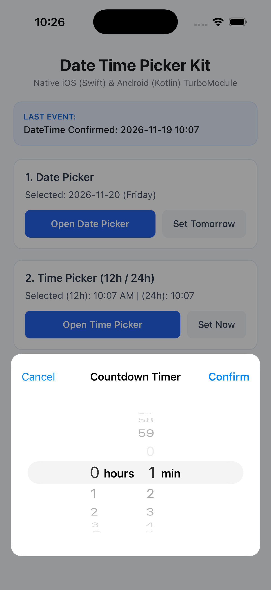

# @izonnet-web-solution/react-native-date-time-picker-kit

A complete, ultra-lightweight, customizable React Native Date & Time Picker library powered by **iOS (Swift + UIKit)** and **Android (Kotlin + Android SDK)** native TurboModules, plus a rich suite of pure React Native calendar and modal components.

[](https://www.npmjs.com/package/@izonnet-web-solution/react-native-date-time-picker-kit)
[](https://opensource.org/licenses/MIT)
[]()
[]()
[]()

---

## Screenshots & Previews

<div align="center">

| iOS Native UIDatePicker | Android Native DatePickerDialog | iOS DateTime Dual Mode |
| :---: | :---: | :---: |
|  |  |  |

| iOS Countdown Wheels | Components & Theming Overview |
| :---: | :---: |
|  |  |

</div>

---

## Table of Contents

1. [Screenshots & Previews](#screenshots--previews)
2. [Features](#features)
3. [Platform Support & Architecture](#platform-support--architecture)
4. [Zero Dependency Policy](#zero-dependency-policy)
5. [Installation & Setup](#installation--setup)
   - [iOS Setup](#ios-setup)
   - [Android Setup](#android-setup)
6. [Quick Start](#quick-start)
7. [Presentation Modes](#presentation-modes)
8. [Theme System](#theme-system)
9. [Component Catalog](#component-catalog)
   - [1. `DateTimePicker`](#1-datetimepicker-unified)
   - [2. `DatePicker`](#2-datepicker)
   - [3. `TimePicker`](#3-timepicker)
   - [4. `DateRangePicker`](#4-daterangepicker)
   - [5. `CalendarPicker`](#5-calendarpicker)
   - [6. `MonthPicker`](#6-monthpicker)
   - [7. `YearPicker`](#7-yearpicker)
   - [8. `ClockPicker`](#8-clockpicker)
   - [9. `WheelPicker`](#9-wheelpicker)
   - [10. `TimeSlotPicker`](#10-timeslotpicker)
10. [Quick Date Presets](#quick-date-presets)
11. [Appointment Time Slots](#appointment-time-slots)
12. [Localization & RTL](#localization--rtl)
13. [Imperative Ref APIs](#imperative-ref-apis)
14. [Custom Hook (`useDateTimePicker`)](#custom-hook-usedatetimepicker)
15. [Date Validation & Conversion Utilities](#date-validation--conversion-utilities)
16. [Error Handling & Error Codes](#error-handling--error-codes)
17. [Props Reference Table](#props-reference-table)
18. [Compatibility Matrix](#compatibility-matrix)
19. [Contributing](#contributing)
20. [License](#license)

---

## Features

- **True Native UI**: Native **Swift** (`UIDatePicker`) on iOS and **Kotlin** (`DatePickerDialog`, `TimePickerDialog`) on Android.
- **Zero Third-Party Runtime Dependencies**: No Moment.js, Day.js, date-fns, react-native-modal, or community picker wrappers.
- **TurboModule Architecture**: Typed React Native Codegen specifications with promise-based async operations and UI thread safety.
- **5 Presentation Modes**:
  - `native`: Platform-native dialogs and sheet modals via TurboModules.
  - `inline`: In-tree custom calendar/clock embedded directly in view hierarchy.
  - `bottom-sheet`: Animated slide-up bottom sheet with grab handle and backdrop dimming.
  - `modal`: Centered dialog with backdrop blur/dim.
  - `fullscreen`: Fullscreen overlay modal.
- **Theme Engine**: Light mode, Dark mode, Automatic system detection, and custom `ThemeConfig` (colors, typography, spacing, border radii).
- **10 Specialized Components**: `DateTimePicker`, `DatePicker`, `TimePicker`, `DateRangePicker`, `CalendarPicker`, `MonthPicker`, `YearPicker`, `ClockPicker`, `WheelPicker`, `TimeSlotPicker`.
- **Advanced Features**: Date range selection, appointment time slot generator, quick presets (Today, Yesterday, Last 7 Days, This Month), marked dates with colored dots and badges.
- **Comprehensive Localization**: Device locale auto-detection, built-in locale presets (English, Hindi, Gujarati, Spanish, French, German, Arabic, Chinese, Japanese), custom locale overrides, and RTL layout support.
- **Developer Flexibility**: Declarative component, imperative ref methods, and custom React hook (`useDateTimePicker`).

---

## Platform Support & Architecture

| Platform | Native Technology | Architecture | Minimum Version |
| :--- | :--- | :--- | :--- |
| **iOS** | Swift 5.0 + UIKit (`UIDatePicker`, `UIViewController`) | TurboModule Spec (Obj-C++ JSI wrapper) | iOS 15.1+ |
| **Android** | Kotlin 1.9+ + Android SDK (`DatePickerDialog`, `TimePickerDialog`) | TurboModule Spec (JNI C++ / Java wrapper) | Android API 24+ (Android 7.0+) |

### React Native New Architecture & Expo Compatibility

- **React Native New Architecture (Fabric & TurboModules):** Fully supported natively with typed Codegen specifications on React Native 0.74 – 0.88+.
- **Expo Compatibility:** Fully compatible with **Expo Prebuild** (`npx expo run:ios`, `npx expo run:android`) and **Expo Development Client** (`expo-dev-client`).
- **Note on Expo Go:** Because this library incorporates high-performance native Swift and Kotlin TurboModules, it requires a custom development client (`npx expo run:ios/android`) rather than standard Expo Go. Pure in-tree JS modes (`inline`, `modal`, `bottom-sheet`) work across all React Native platforms.

---

## Zero Dependency Policy

This library maintains **0 runtime dependencies**.
- All date calculations, range validations, leap-year handling, and token formatting are implemented in pure TypeScript.
- All animations utilize React Native's built-in `Animated` and native drivers.
- No heavy date libraries (`moment`, `date-fns`, `dayjs`) are introduced into your bundle.

---

## Installation & Setup

```bash
# npm
npm install @izonnet-web-solution/react-native-date-time-picker-kit

# yarn
yarn add @izonnet-web-solution/react-native-date-time-picker-kit

# pnpm
pnpm add @izonnet-web-solution/react-native-date-time-picker-kit
```

### iOS Setup

Install CocoaPods dependencies:

```bash
cd ios && pod install
```

The podspec automatically configures the Swift TurboModule (`DateTimePickerKitImpl`) and module headers.

### Android Setup

In your React Native project, ensure New Architecture is enabled (standard in RN 0.76+):

```properties
# android/gradle.properties
newArchEnabled=true
```

---

## Quick Start

```tsx
import React, { useState } from 'react';
import { View, Button, Text } from 'react-native';
import {
  DateTimePicker,
  formatDate,
} from '@izonnet-web-solution/react-native-date-time-picker-kit';

export default function BasicExample() {
  const [date, setDate] = useState(new Date());
  const [show, setShow] = useState(false);

  return (
    <View style={{ padding: 20 }}>
      <Text>Selected: {formatDate(date, 'YYYY-MM-DD')}</Text>
      <Button title="Choose Date" onPress={() => setShow(true)} />

      {show && (
        <DateTimePicker
          mode="date"
          presentation="native"
          value={date}
          onConfirm={(selectedDate) => {
            setShow(false);
            setDate(selectedDate);
          }}
          onCancel={() => setShow(false)}
        />
      )}
    </View>
  );
}
```

---

## Presentation Modes

All components support 5 presentation modes via the `presentation` prop:

| Mode | Description |
| :--- | :--- |
| `'native'` *(default)* | Native OS dialogs/sheets (`UIDatePicker` on iOS, `DatePickerDialog` on Android). |
| `'bottom-sheet'` | Slide-up bottom sheet with grab handle, backdrop dimming, and header. |
| `'modal'` | Center-aligned modal dialog. |
| `'inline'` | Directly rendered into the parent view tree without any modal overlay. |
| `'fullscreen'` | Fullscreen modal overlay with safe area padding. |

```tsx
<DatePicker
  presentation="bottom-sheet" // or "inline", "modal", "native"
  value={new Date()}
  onConfirmDate={(d) => console.log(d)}
/>
```

---

## Theme System

Built-in themes support light mode, dark mode, auto system scheme, or customized palettes.

### Built-in Modes

```tsx
<DateTimePicker theme="light" />
<DateTimePicker theme="dark" />
<DateTimePicker theme="auto" /> // Automatically follows device dark mode
```

### Custom Theme Configuration

```tsx
const customTheme = {
  mode: 'light',
  colors: {
    primary: '#6366F1', // Indigo accent
    selected: '#6366F1',
    selectedText: '#FFFFFF',
    background: '#FAFAFA',
    rangeHighlight: '#E0E7FF',
  },
  borderRadius: {
    lg: 20,
  },
};

<CalendarPicker theme={customTheme} />
```

---

## Component Catalog

### 1. `DateTimePicker` (Unified)

The core unified component supporting all modes (`date`, `time`, `datetime`, `countdown`) and presentations.

```tsx
<DateTimePicker
  mode="datetime"
  presentation="bottom-sheet"
  value={new Date()}
  minuteInterval={5}
  onConfirm={(date) => console.log('Confirmed:', date)}
/>
```

### 2. `DatePicker`

Dedicated single date picker component with optional presets.

```tsx
const pickerRef = useRef<DatePickerRef>(null);

<DatePicker
  ref={pickerRef}
  presentation="bottom-sheet"
  value={selectedDate}
  showPresets
  onConfirmDate={(date) => setSelectedDate(date)}
/>
```

### 3. `TimePicker`

Dedicated time picker component supporting 12h / 24h formats and minute intervals.

```tsx
<TimePicker
  presentation="modal"
  is24Hour={false}
  minuteInterval={15}
  onConfirmTime={(time) => console.log(time)}
/>
```

### 4. `DateRangePicker`

Select a start date and an end date with visual range highlighting and quick presets.

```tsx
<DateRangePicker
  presentation="bottom-sheet"
  showPresets
  startDate={range.startDate}
  endDate={range.endDate}
  onConfirmRange={({ startDate, endDate }) => {
    console.log('Range:', startDate, 'to', endDate);
  }}
/>
```

### 5. `CalendarPicker`

Full-featured inline or standalone calendar component with marked dates and RTL support.

```tsx
<CalendarPicker
  value={new Date()}
  onChange={(d) => console.log(d)}
  markedDates={{
    '2026-11-20': { marked: true, dotColor: '#EF4444' },
    '2026-11-25': { marked: true, dotColor: '#10B981' },
  }}
  firstDayOfWeek={0} // 0 = Sunday, 1 = Monday
/>
```

### 6. `MonthPicker`

3x4 month selection grid with decade navigation.

```tsx
<MonthPicker
  value={{ year: 2026, month: 10 }}
  onChange={({ year, month, date }) => {
    console.log('Selected Month:', month, 'Year:', year);
  }}
/>
```

### 7. `YearPicker`

Decade-paginated year selection grid.

```tsx
<YearPicker
  value={2026}
  minYear={2000}
  maxYear={2040}
  onChange={(year) => console.log('Year:', year)}
/>
```

### 8. `ClockPicker`

Interactive 12-hour / 24-hour digital clock picker with segmented hour/minute controls and AM/PM toggles.

```tsx
<ClockPicker
  value={{ hour: 10, minute: 30 }}
  is24Hour={false}
  minuteInterval={5}
  onChange={({ hour, minute, date }) => console.log(hour, minute)}
/>
```

### 9. `WheelPicker`

Zero-dependency, smooth scroll wheel picker built on React Native's `ScrollView`.

```tsx
<WheelPicker
  items={[
    { label: 'Morning (09:00 AM)', value: 'morning' },
    { label: 'Afternoon (01:00 PM)', value: 'afternoon' },
    { label: 'Evening (05:00 PM)', value: 'evening' },
  ]}
  selectedValue="morning"
  onChange={(val, index) => console.log(val)}
/>
```

### 10. `TimeSlotPicker`

Appointment time slot selection grid with auto-generation and disabled slot support.

```tsx
<TimeSlotPicker
  startTime="09:00"
  endTime="17:00"
  intervalMinutes={30}
  disabledSlots={['12:00', '12:30']}
  onSelectSlot={(slot) => console.log('Booked slot:', slot.id)}
/>
```

---

## Quick Date Presets

Generate standard presets for single dates and date ranges:

```tsx
import {
  getStandardRangePresets,
  getStandardSinglePresets,
} from '@izonnet-web-solution/react-native-date-time-picker-kit';

// Built-in presets: Today, Yesterday, Last 7 Days, Last 30 Days, This Month, Next Month
const rangePresets = getStandardRangePresets();
```

---

## Appointment Time Slots

Generate slots for scheduling workflows:

```tsx
import { generateTimeSlots } from '@izonnet-web-solution/react-native-date-time-picker-kit';

const slots = generateTimeSlots({
  startTime: '09:00',
  endTime: '18:00',
  intervalMinutes: 30,
  disabledSlots: ['13:00', '13:30'], // Lunch break
  is24Hour: false,
});
```

---

## Localization & RTL

### Built-in Locales

- `en` (English - default)
- `hi` (Hindi - हिन्दी)
- `gu` (Gujarati - ગુજરાતી)
- `es` (Spanish - Español)
- `fr` (French - Français)
- `de` (German - Deutsch)
- `ar` (Arabic - العربية with automatic RTL layout)
- `zh` (Chinese - 中文)
- `ja` (Japanese - 日本語)

```tsx
<CalendarPicker locale="hi" />
<DateTimePicker locale="gu" />
<CalendarPicker locale="ar" /> // Flips weekday order and navigation arrows for RTL
```

### Formatted Localized Output

```tsx
import { formatLocalized, hiLocale } from '@izonnet-web-solution/react-native-date-time-picker-kit';

const str = formatLocalized(new Date(), 'DD MMMM YYYY (dddd) A', hiLocale);
// Output: "19 नवंबर 2026 (गुरुवार) पूर्वाह्न"
```

---

## Imperative Ref APIs

Control pickers programmatically via React refs:

```tsx
const pickerRef = useRef<DateTimePickerRef>(null);

// Open picker
await pickerRef.current?.open();

// Programmatic confirm / cancel / close
await pickerRef.current?.confirm();
await pickerRef.current?.cancel();
await pickerRef.current?.close();

// Value access
const value = pickerRef.current?.getValue();
pickerRef.current?.setValue(new Date());
pickerRef.current?.reset();
```

---

## Custom Hook (`useDateTimePicker`)

```tsx
import { useDateTimePicker } from '@izonnet-web-solution/react-native-date-time-picker-kit';

function HookExample() {
  const { ref, open, isOpen } = useDateTimePicker({
    mode: 'date',
  });

  return (
    <View>
      <Button title={isOpen ? 'Open' : 'Choose'} onPress={() => open()} />
      <DateTimePicker ref={ref} mode="date" />
    </View>
  );
}
```

---

## Date Validation & Conversion Utilities

```tsx
import {
  validateDate,
  validateDateRange,
  isDateDisabled,
  isWeekdayDisabled,
  validateMinuteInterval,
  formatDate,
  parseDate,
} from '@izonnet-web-solution/react-native-date-time-picker-kit';

// Check date validity
validateDate(new Date()); // true

// Format using custom tokens
formatDate(new Date(), 'YYYY-MM-DD hh:mm A'); // "2026-11-19 10:30 AM"

// Check disabled dates
isDateDisabled(new Date(), ['2026-12-25'], [0, 6]); // true if Dec 25 or Weekend
```

---

## Error Handling & Error Codes

The library exposes strongly typed `DateTimePickerError` instances:

```tsx
import { DateTimePickerError, type DateTimePickerErrorCode } from '@izonnet-web-solution/react-native-date-time-picker-kit';

<DateTimePicker
  onError={(error: DateTimePickerError) => {
    console.error('Picker error code:', error.code);
    console.error('Picker error message:', error.message);
  }}
/>
```

Available error codes:
- `NATIVE_MODULE_NOT_FOUND`
- `PICKER_ALREADY_OPEN`
- `PICKER_NOT_OPEN`
- `INVALID_DATE`
- `INVALID_MODE`
- `INVALID_MINUTE_INTERVAL`
- `DATE_OUT_OF_RANGE`
- `UNSUPPORTED_FEATURE`
- `ACTIVITY_UNAVAILABLE`
- `PRESENTATION_FAILED`
- `UNKNOWN_ERROR`

---

## Props Reference Table

Complete reference for `<DateTimePicker />` and derived pickers (`DatePicker`, `TimePicker`, `DateRangePicker`, etc.):

| Prop | Type | Default | Required | Description |
| :--- | :--- | :--- | :--- | :--- |
| `mode` | `'date' \| 'time' \| 'datetime' \| 'countdown'` | `'date'` | No | Selection mode for the picker. |
| `value` | `Date \| number \| string \| null` | `null` | No | Controlled date value. Accepts a `Date` object, millisecond epoch number, or ISO string. |
| `defaultValue` | `Date \| number \| string \| null` | `null` | No | Uncontrolled initial date value. |
| `presentation` | `'native' \| 'inline' \| 'modal' \| 'bottom-sheet' \| 'fullscreen'` | `'native'` | No | Display presentation container. Native launches OS modal; others render pure in-tree UI. |
| `display` | `'default' \| 'compact' \| 'inline' \| 'spinner' \| 'clock'` | `'default'` | No | Visual style for native pickers on iOS and Android. |
| `open` | `boolean` | `false` | No | Controls modal visibility in declarative presentation modes. |
| `isVisible` | `boolean` | `false` | No | Convenience alias for `open` or `visible`. |
| `minimumDate` | `Date \| number \| string` | `undefined` | No | Lower date/time boundary. Clamps selection and disables dates prior to this value. |
| `minDate` | `Date \| number \| string` | `undefined` | No | Convenience alias for `minimumDate`. |
| `maximumDate` | `Date \| number \| string` | `undefined` | No | Upper date/time boundary. Clamps selection and disables dates after this value. |
| `maxDate` | `Date \| number \| string` | `undefined` | No | Convenience alias for `maximumDate`. |
| `minimumTime` | `string \| { hour: number; minute: number }` | `undefined` | No | Minimum allowable time boundary (e.g. `"09:00"` or `{ hour: 9, minute: 0 }`). |
| `maximumTime` | `string \| { hour: number; minute: number }` | `undefined` | No | Maximum allowable time boundary (e.g. `"17:00"` or `{ hour: 17, minute: 0 }`). |
| `minuteInterval` | `1 \| 2 \| 3 \| 4 \| 5 \| 6 \| 10 \| 12 \| 15 \| 20 \| 30` | `1` | No | Interval stepping for minute wheel or clock. |
| `locale` | `string \| PartialLocaleData` | Device locale | No | BCP 47 locale tag (`'en'`, `'es'`, `'fr'`, `'hi'`, `'ja'`, etc.) or custom locale dictionary. |
| `timeZone` | `string` | Device TZ | No | Target IANA timezone identifier (e.g., `'America/New_York'`, `'Asia/Kolkata'`). |
| `timeZoneOffsetInMinutes`| `number` | `undefined` | No | Target UTC offset in minutes (e.g. `330` for IST `+05:30`). |
| `utcOffset` | `number` | `undefined` | No | Convenience alias for `timeZoneOffsetInMinutes` (accepts hours e.g. `5.5` or minutes `330`). |
| `is24Hour` | `boolean` | Locale default | No | Explicit override for 24-hour time formatting instead of 12-hour AM/PM. |
| `disabledDates` | `(Date \| string)[]` | `[]` | No | Array of dates or ISO strings to disable from selection. |
| `disabledWeekdays` | `number[]` | `[]` | No | Array of weekday indices to disable (0 = Sunday, 1 = Monday, ..., 6 = Saturday). |
| `markedDates` | `MarkedDatesMap` | `{}` | No | Mapping of date keys (`YYYY-MM-DD`) with colored dots, badges, or custom highlights. |
| `firstDayOfWeek` | `number` | `0` (Sun) | No | First day of the week in calendar grids (0 = Sunday, 1 = Monday, 6 = Saturday). |
| `theme` | `'light' \| 'dark' \| 'auto' \| ThemeConfig` | `'auto'` | No | Visual theme mode or complete customized ThemeConfig design tokens. |
| `themeColors` | `ThemeColorsOverride` | `undefined` | No | Clean palette overrides (`backgroundColor`, `textColor`, `accentColor`, `dividerColor`). |
| `styles` | `{ headerStyle?, confirmButtonStyle?, cancelButtonStyle?, containerStyle? }` | `undefined` | No | Style overrides for modal container, header, and action buttons. |
| `title` | `string` | Mode title | No | Modal header or native dialog title. |
| `confirmText` | `string` | `'Confirm'` | No | Text label for the confirmation button. |
| `cancelText` | `string` | `'Cancel'` | No | Text label for the cancellation button. |
| `accentColor` | `string` | Theme primary | No | Accent color for active selections, highlights, and buttons. |
| `textColor` | `string` | Theme text | No | Base text color. |
| `backgroundColor` | `string` | Theme surface | No | Modal and component background color. |
| `showPresets` | `boolean` | `false` | No | Whether to show quick date presets bar (Today, Yesterday, Last 7 Days, This Month). |
| `customPresets` | `DatePreset[]` | `undefined` | No | Custom array of date presets to render. |
| `disabled` | `boolean` | `false` | No | When true, disables user interaction with the picker. |
| `onChange` | `(event: { date: Date; mode: string }) => void` | `undefined` | No | Callback invoked on intermediate date or time selection changes. |
| `onConfirm` | `(date: Date) => void` | `undefined` | No | Callback invoked when user confirms selection with the finalized `Date`. |
| `onCancel` | `() => void` | `undefined` | No | Callback invoked when user cancels or dismisses picker. |
| `onDismiss` | `() => void` | `undefined` | No | Callback invoked when native dialog is dismissed. |
| `onOpen` | `() => void` | `undefined` | No | Callback invoked when picker modal opens. |
| `onError` | `(error: DateTimePickerError) => void` | `undefined` | No | Callback invoked if an error occurs during presentation or date calculation. |
| `testID` | `string` | `undefined` | No | Identifier for end-to-end automated testing. |

---

## Compatibility Matrix

| Library Version | React Native | iOS | Android | New Architecture |
| :--- | :--- | :--- | :--- | :--- |
| `1.0.0` | `0.74.0` – `0.88.x+` | iOS 15.1+ | API 24+ (Android 7.0+) | **Yes (Required)** |

---

## Contributing

We welcome community contributions, bug reports, and feature suggestions!

### Local Development Setup

1. **Clone the repository:**
   ```bash
   git clone https://github.com/Izonnet-Web-Solution/react-native-date-time-picker-kit.git
   cd react-native-date-time-picker-kit
   ```

2. **Install dependencies:**
   ```bash
   npm install
   ```

3. **Run code quality checks & tests:**
   ```bash
   # Run typechecks
   npm run typecheck

   # Run ESLint
   npm run lint

   # Run automated Jest test suite
   npm test
   ```

4. **Build distribution binaries:**
   ```bash
   npm run prepare
   ```

### Submitting Pull Requests

1. Fork the repo and create your feature branch: `git checkout -b feat/my-new-feature`.
2. Commit your changes with descriptive commit messages following Conventional Commits format (`feat:`, `fix:`, `docs:`, `test:`).
3. Ensure all 106+ unit tests pass and code passes `npm run lint` and `npm run typecheck`.
4. Open a Pull Request on GitHub with a clear explanation of your changes.

---

## License

MIT © [Izonnet Web Solution](https://github.com/izonnet-web-solution)
