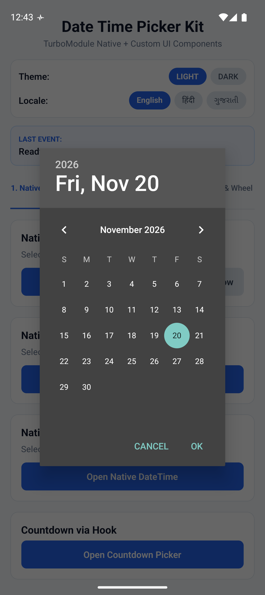
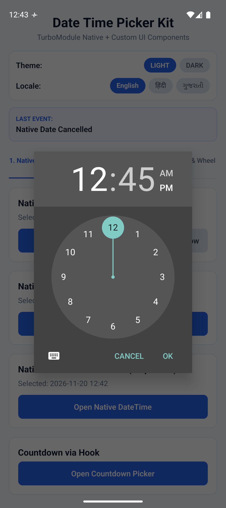
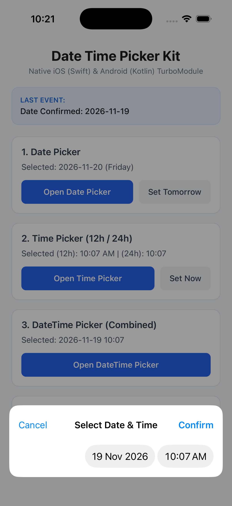
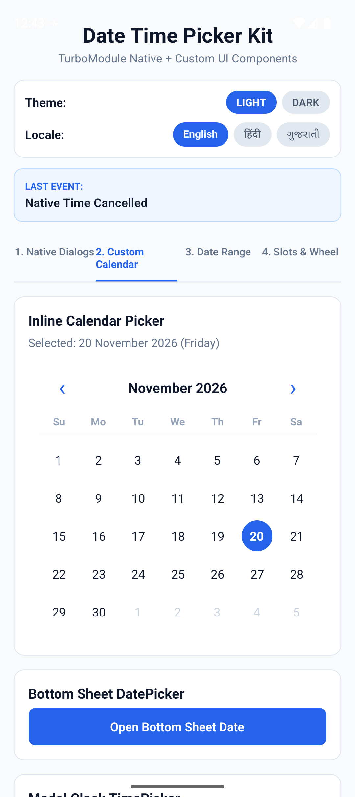
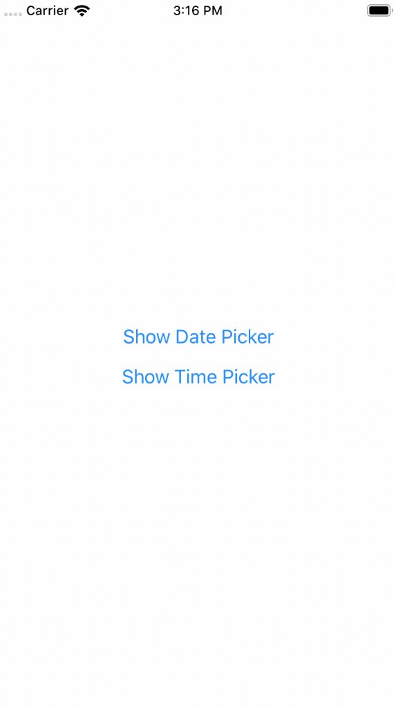

# @izonnet-web-solution/react-native-date-time-modal

> High-performance, production-ready, fully native cross-platform Date & Time Picker library for React Native. Engineered with **zero runtime dependencies** as a drop-in replacement for `react-native-modal-datetime-picker`.

[](https://www.npmjs.com/package/@izonnet-web-solution/react-native-date-time-modal)
[](https://opensource.org/licenses/MIT)
[](https://www.typescriptlang.org/)
[](https://www.npmjs.com/package/@izonnet-web-solution/react-native-date-time-modal)
[](https://reactnative.dev/docs/the-new-architecture/landing-page)
[](https://github.com/Izonnet-Web-Solution/react-native-date-time-picker-kit)

---

## 📸 Visual Showcase

<div align="center">

| iOS Date Picker (ActionSheet Layout) | Android Date Picker (Material Dialog) |
| :---: | :---: |
| <br/><sub><b>iOS UIKit ActionSheet Two-Card Modal</b><br/>(UIDatePicker Wheels + Confirm + Cancel)</sub> | <br/><sub><b>Android Native Material Dialog</b><br/>(Material DatePickerDialog header & calendar)</sub> |

| iOS Time Picker | Android Time Picker (Radial Clock) |
| :---: | :---: |
| <br/><sub><b>iOS Time Wheels Picker</b><br/>(Haptic feedback, minute intervals)</sub> | <br/><sub><b>Android Radial Clock Dialog</b><br/>(12h/24h toggle, AM/PM, smooth selection)</sub> |

| iOS DateTime Picker | Android DateTime Presentation |
| :---: | :---: |
| <br/><sub><b>iOS Unified DateTime Presentation</b><br/>(Smooth wheels date & time combined modal)</sub> | <br/><sub><b>Android DateTime Flow</b><br/>(Sequential native DatePickerDialog followed by TimePickerDialog)</sub> |

| Example App (iOS) | Example App (Android) |
| :---: | :---: |
| <br/><sub><b>iOS Example Screen</b><br/>(Centered interactive action buttons)</sub> | <br/><sub><b>Android Example Screen</b><br/>(Material theme button layout)</sub> |

</div>

---

## Table of Contents

1. [Library Introduction](#1-library-introduction)
2. [Features](#2-features)
3. [iOS and Android Support](#3-ios-and-android-support)
4. [Architecture](#4-architecture)
5. [Installation](#5-installation)
6. [React Native Compatibility](#6-react-native-compatibility)
7. [Basic Usage](#7-basic-usage)
8. [Date Picker Example](#8-date-picker-example)
9. [Time Picker Example](#9-time-picker-example)
10. [DateTime Picker Example](#10-datetime-picker-example)
11. [Modal Usage](#11-modal-usage)
12. [Hook Usage](#12-hook-usage)
13. [Imperative Ref Methods](#13-imperative-ref-methods)
14. [Complete Props Documentation](#14-complete-props-documentation)
15. [Callback Documentation](#15-callback-documentation)
16. [TypeScript Examples](#16-typescript-examples)
17. [Customization](#17-customization)
18. [Theme Support](#18-theme-support)
19. [Localization](#19-localization)
20. [Date Validation](#20-date-validation)
21. [Platform-Specific Behavior](#21-platform-specific-behavior)
22. [Platform Limitations](#22-platform-limitations)
23. [Troubleshooting](#23-troubleshooting)
24. [Example Application](#24-example-application)
25. [Contributing](#25-contributing)
26. [License](#26-license)

---

## 1. Library Introduction

`@izonnet-web-solution/react-native-date-time-modal` is a specialized, lightweight React Native library providing native date and time picking functionality. Built directly on top of Swift for iOS and Kotlin for Android through React Native's modern TurboModule architecture, it guarantees 60fps animations, zero bridge lag, and native OS look-and-feel without any third-party dependencies.

---

## 2. Features

- **100% Fully Native**: Swift (`UIDatePicker`) on iOS; Kotlin (`DatePickerDialog` & `TimePickerDialog`) on Android.
- **Zero Runtime Dependencies**: No external JavaScript date libraries, bloated moment/dayjs bundles, or custom UI engines.
- **Drop-in Replacement for `react-native-modal-datetime-picker`**: Identical component names, props, and callback signatures.
- **ActionSheet Two-Card UI on iOS**: Top card contains `UIDatePicker` + separator + Confirm button; bottom card contains Cancel button with smooth slide-up animation.
- **Android Material Dialogs**: Clean Android SDK Material pickers with boundary safety and 12h/24h toggle.
- **Four Picker Modes**: `'date'`, `'time'`, `'datetime'`, and `'countdown'` (iOS).
- **Dual Declarative & Imperative APIs**: Use via React JSX `<DateTimePickerModal isVisible={...} />` or async `openDateTimePickerModal({ ... })`.
- **Comprehensive Lifecycle Events**: `onConfirm`, `onCancel`, `onHide`, `onChange`, `onDismiss`, `onOpen`, and `onError`.
- **Strict TypeScript Typing**: Fully typed props, ref interfaces, and union types.

---

## 3. iOS and Android Support

| Platform | Native Component | Min OS Version | New Architecture (TurboModule) | Old Architecture (Bridge) |
| :--- | :--- | :---: | :---: | :---: |
| **iOS** | `UIDatePicker` (UIKit / Swift) | iOS 13.4+ | ✅ Supported | ✅ Supported |
| **Android** | `DatePickerDialog` & `TimePickerDialog` (Kotlin) | Android 5.0 (API 21+) | ✅ Supported | ✅ Supported |

---

## 4. Architecture

```
┌─────────────────────────────────────────────────────────────┐
│                 React Native TypeScript Layer               │
│                                                             │
│   <DateTimePickerModal />  │  <DateTimePicker />            │
│   openDateTimePickerModal()│  useDateTimePicker()           │
└──────────────────────────────┬──────────────────────────────┘
                               │
                       TurboModule / JSI
                  (NativeDateTimePickerKitSpec)
                               │
        ┌──────────────────────┴──────────────────────┐
        ▼                                             ▼
┌──────────────────────────────┐        ┌──────────────────────────────┐
│         iOS (Swift)          │        │       Android (Kotlin)       │
│ • UIDatePicker (UIKit)       │        │ • DatePickerDialog (SDK)    │
│ • ActionSheet Two-Card UI    │        │ • TimePickerDialog (SDK)    │
│ • Zero Third-Party Pods      │        │ • Zero Third-Party JAR/AAR   │
└──────────────────────────────┘        └──────────────────────────────┘
```

---

## 5. Installation

```bash
# npm
npm install @izonnet-web-solution/react-native-date-time-modal

# yarn
yarn add @izonnet-web-solution/react-native-date-time-modal

# pnpm
pnpm add @izonnet-web-solution/react-native-date-time-modal
```

### iOS CocoaPods Setup

```bash
cd ios && pod install && cd ..
```

### Android Setup

Automatic linking is fully supported. No manual changes to `MainApplication.kt` or `settings.gradle` are required.

---

## 6. React Native Compatibility

| React Native Version | Supported | Architecture |
| :--- | :---: | :--- |
| **0.76.x - 0.88.x+** | ✅ Yes | TurboModule (New Architecture default) |
| **0.70.x - 0.75.x** | ✅ Yes | Backward-compatible bridge fallback |
| **Expo (SDK 50+)** | ✅ Yes | Config plugin / prebuild auto-linking |

---

## 7. Basic Usage

```tsx
import React, { useState } from 'react';
import { Button, StyleSheet, Text, View } from 'react-native';
import DateTimePickerModal from '@izonnet-web-solution/react-native-date-time-modal';

export default function App() {
  const [isDatePickerVisible, setDatePickerVisibility] = useState(false);
  const [selectedDate, setSelectedDate] = useState<string | null>(null);

  const showDatePicker = () => setDatePickerVisibility(true);
  const hideDatePicker = () => setDatePickerVisibility(false);

  const handleConfirm = (date: Date) => {
    setSelectedDate(date.toLocaleDateString());
    hideDatePicker();
  };

  return (
    <View style={styles.container}>
      <Button title="Show Date Picker" onPress={showDatePicker} />
      {selectedDate && (
        <Text style={styles.output}>A date has been picked: {selectedDate}</Text>
      )}

      <DateTimePickerModal
        isVisible={isDatePickerVisible}
        mode="date"
        onConfirm={handleConfirm}
        onCancel={hideDatePicker}
      />
    </View>
  );
}

const styles = StyleSheet.create({
  container: {
    flex: 1,
    alignItems: 'center',
    justifyContent: 'center',
    backgroundColor: '#FFFFFF',
  },
  output: {
    marginTop: 20,
    fontSize: 16,
    color: '#007AFF',
  },
});
```

---

## 8. Date Picker Example

```tsx
<DateTimePickerModal
  isVisible={isDateVisible}
  mode="date"
  date={new Date()}
  minimumDate={new Date(2020, 0, 1)}
  maximumDate={new Date(2030, 11, 31)}
  onConfirm={(date) => {
    console.log('Selected date:', date);
    setDateVisible(false);
  }}
  onCancel={() => setDateVisible(false)}
/>
```

---

## 9. Time Picker Example

```tsx
<DateTimePickerModal
  isVisible={isTimeVisible}
  mode="time"
  date={new Date()}
  is24Hour={false}
  minuteInterval={15}
  onConfirm={(time) => {
    console.log('Selected time:', time);
    setTimeVisible(false);
  }}
  onCancel={() => setTimeVisible(false)}
/>
```

---

## 10. DateTime Picker Example

```tsx
<DateTimePickerModal
  isVisible={isDateTimeVisible}
  mode="datetime"
  date={new Date()}
  onConfirm={(dateTime) => {
    console.log('Selected date and time:', dateTime);
    setDateTimeVisible(false);
  }}
  onCancel={() => setDateTimeVisible(false)}
/>
```

---

## 11. Modal Usage

`DateTimePickerModal` wraps the native TurboModule and presents an OS-level modal window:
- **On iOS**: ActionSheet two-card modal sliding from bottom.
- **On Android**: System Material dialog centered on screen.

Tapping the backdrop overlay dismisses the picker and invokes `onCancel` followed by `onHide(false)`.

---

## 12. Hook Usage

The `useDateTimePicker` hook provides headless state management:

```tsx
import { useDateTimePicker } from '@izonnet-web-solution/react-native-date-time-modal';

export default function HookExample() {
  const { isVisible, open, close, value, onConfirm, onCancel } = useDateTimePicker({
    mode: 'date',
    initialDate: new Date(),
  });

  return (
    <View>
      <Button title="Open Picker" onPress={open} />
      <Text>Value: {value?.toLocaleDateString()}</Text>

      <DateTimePickerModal
        isVisible={isVisible}
        date={value}
        onConfirm={onConfirm}
        onCancel={onCancel}
      />
    </View>
  );
}
```

---

## 13. Imperative Ref Methods

You can trigger the picker imperatively using a `ref` or `openDateTimePickerModal`:

```tsx
import { useRef } from 'react';
import {
  DateTimePicker,
  type DateTimePickerRef,
  openDateTimePickerModal,
} from '@izonnet-web-solution/react-native-date-time-modal';

// Method 1: Using async helper
const pickDateAsync = async () => {
  const date = await openDateTimePickerModal({
    mode: 'date',
    date: new Date(),
  });
  if (date) {
    console.log('Picked date:', date);
  }
};

// Method 2: Using Component Ref
const pickerRef = useRef<DateTimePickerRef>(null);

const handleOpen = () => pickerRef.current?.open();
const handleClose = () => pickerRef.current?.close();
const handleConfirm = () => pickerRef.current?.confirm();
const handleCancel = () => pickerRef.current?.cancel();
const handleReset = () => pickerRef.current?.reset();
```

---

## 14. Complete Props Documentation

| Prop | Type | Default | Description |
| :--- | :--- | :--- | :--- |
| `isVisible` | `boolean` | `false` | Controls visibility of the modal dialog. |
| `date` / `value` | `Date \| number \| string` | `new Date()` | Selected or initial date value. |
| `mode` | `'date' \| 'time' \| 'datetime' \| 'countdown'` | `'date'` | Picker selection mode. |
| `display` | `'default' \| 'spinner' \| 'compact' \| 'inline'` | `'default'` | Display presentation style. |
| `minimumDate` / `minDate` | `Date \| number \| string` | `undefined` | Lower boundary date. |
| `maximumDate` / `maxDate` | `Date \| number \| string` | `undefined` | Upper boundary date. |
| `minuteInterval` | `1 \| 2 \| 3 \| 4 \| 5 \| 6 \| 10 \| 12 \| 15 \| 20 \| 30` | `1` | Minute snapping interval. |
| `timeZoneOffsetInMinutes` | `number` | `undefined` | Timezone offset in minutes relative to GMT/UTC. |
| `is24Hour` | `boolean` | `false` | Force 24-hour time presentation on Android. |
| `isDarkModeEnabled` | `boolean` | `undefined` | Force Dark Mode appearance. |
| `confirmTextIOS` | `string` | `'Confirm'` | Label for the iOS confirmation button. |
| `cancelTextIOS` | `string` | `'Cancel'` | Label for the iOS cancel button. |
| `accentColorIOS` | `string` | `'#007AFF'` | Color tint for iOS controls. |
| `buttonTextColorIOS` | `string` | `'#007AFF'` | Text color for iOS buttons. |
| `locale` | `string` | Device default | Locale identifier (e.g. `'en_US'`, `'es_ES'`). |
| `testID` | `string` | `undefined` | Test identifier for automated testing. |

---

## 15. Callback Documentation

| Callback | Signature | Description |
| :--- | :--- | :--- |
| `onConfirm` | `(date: Date) => void` | Invoked when the user taps Confirm. |
| `onCancel` | `() => void` | Invoked when the user taps Cancel or dismisses the dialog. |
| `onHide` | `(isConfirmed: boolean, date?: Date) => void` | Invoked after the modal has completed dismissal animation. |
| `onChange` | `(date: Date) => void` | Invoked on intermediate date or time changes. |
| `onDismiss` | `() => void` | Invoked when the dialog is dismissed. |
| `onOpen` | `() => void` | Invoked when the picker modal is presented. |
| `onError` | `(error: DateTimePickerError) => void` | Invoked if an error occurs during presentation. |

---

## 16. TypeScript Examples

```tsx
import type {
  DateTimePickerModalProps,
  DateTimePickerConfirmEvent,
  DateTimePickerHideEvent,
  PickerMode,
} from '@izonnet-web-solution/react-native-date-time-modal';

const handleConfirm: DateTimePickerConfirmEvent = (date: Date) => {
  console.log('Confirmed:', date.toISOString());
};

const handleHide: DateTimePickerHideEvent = (confirmed: boolean, date?: Date) => {
  console.log('Hidden:', confirmed, date);
};

const mode: PickerMode = 'datetime';
```

---

## 17. Customization

### iOS Custom Button Text & Colors

```tsx
<DateTimePickerModal
  isVisible={isVisible}
  mode="date"
  confirmTextIOS="Done"
  cancelTextIOS="Dismiss"
  accentColorIOS="#FF3B30"
  buttonTextColorIOS="#007AFF"
  onConfirm={handleConfirm}
  onCancel={handleCancel}
/>
```

---

## 18. Theme Support

The library supports light and dark themes:
- **System Adaptive (`auto`)**: Automatically follows device appearance.
- **Explicit Override (`isDarkModeEnabled`)**: Enforces dark mode (`true`) or light mode (`false`).

```tsx
<DateTimePickerModal
  isVisible={isVisible}
  isDarkModeEnabled={true}
  onConfirm={handleConfirm}
  onCancel={handleCancel}
/>
```

---

## 19. Localization

Pass standard BCP 47 language tags (e.g. `'en_US'`, `'es_ES'`, `'fr_FR'`, `'ja_JP'`, `'hi_IN'`):

```tsx
<DateTimePickerModal
  isVisible={isVisible}
  locale="es_ES"
  onConfirm={handleConfirm}
  onCancel={handleCancel}
/>
```

---

## 20. Date Validation

The library provides built-in boundary protection:
- Dates before `minimumDate` or after `maximumDate` are clamped.
- Invalid combinations (`minimumDate > maximumDate` or unsupported `minuteInterval`) throw structured `DateTimePickerError` instances with specific error codes.

---

## 21. Platform-Specific Behavior

- **iOS**: Uses `UIDatePicker` in ActionSheet presentation with separate rounded cards for picker actions. Default display is `.wheels` (spinner).
- **Android**: Uses standard Material `DatePickerDialog` (calendar grid) and `TimePickerDialog` (radial clock face).

---

## 22. Platform Limitations

1. **Countdown Mode**: Supported only on iOS (`countDownTimer`). Android will report `UNSUPPORTED_FEATURE`.
2. **Radial Minute Interval**: Android Material clock face natively supports minute selection; custom snapping intervals are enforced programmatically.

---

## 23. Troubleshooting

### Issue: Modal not showing on iOS
Ensure CocoaPods is installed:
```bash
cd ios && pod install && cd ..
```

### Issue: Duplicate dialogs opening
The library contains built-in concurrency guards (`PICKER_ALREADY_OPEN`). Ensure your state toggle is synchronized with `onConfirm` and `onCancel`.

---

## 24. Example Application

The repository includes a complete example application under `example/`.

To run:
```bash
# Start Metro
cd example
npm start

# Run on iOS
npm run ios

# Run on Android
npm run android
```

---

## 25. Contributing

Contributions are welcome! Please check the [CONTRIBUTING.md](file:///Users/mac-m4izonnet/Desktop/Malay/Date-Time-Picker/react-native-date-time-picker-kit/CONTRIBUTING.md) guide before submitting pull requests.

---

## 26. License

MIT License © [Izonnet Web Solution](https://github.com/Izonnet-Web-Solution)
